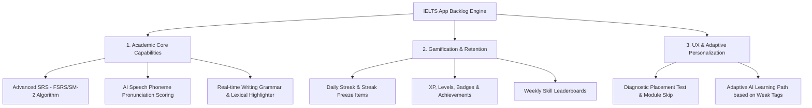
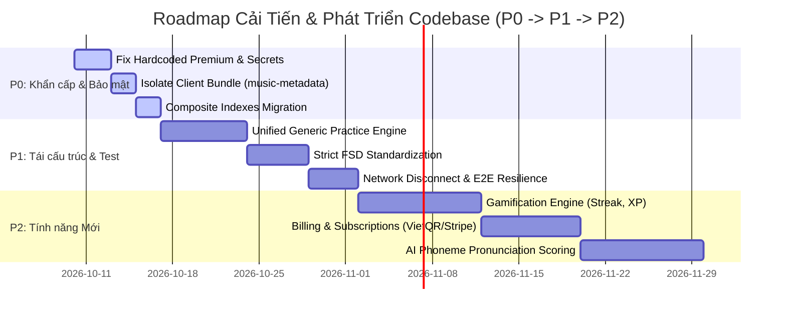

# BÁO CÁO AUDIT & REVIEW TOÀN DIỆN 360 ĐỘ CODEBASE `App-hoc-tieng-anh`

**Vai trò:** Senior Software Architect & Tech Lead (Next.js App Router + Supabase Ecosystem)  
**Ngày thực hiện:** 09/10/2026  
**Đối tượng Audit:** Codebase dự án `App-hoc-tieng-anh` (IELTS Self-Study Application)  
**Mục đích:** Đánh giá khách quan, chi tiết 360 độ về kiến trúc, tính năng, nợ kỹ thuật, độ ổn định, hiệu năng, bảo mật và xây dựng lộ trình cải tiến theo ma trận ưu tiên (P0 / P1 / P2).

---

## PHẦN 1: TỔNG QUAN HIỆN TRẠNG (DỰ ÁN ĐÃ LÀM ĐƯỢC NHỮNG GÌ?)

### 1. Kiến trúc & Tech Stack Thực tế

Codebase đang vận hành trên nền tảng công nghệ hiện đại, kết hợp kiến trúc Modular Monolith định hướng "Server-First" và "Domain-Oriented":

- **Frontend Core:** Next.js 16.2.10 (App Router), React 19.2.7, TypeScript 6.0.3 (`strict: true`), Tailwind CSS v4.3.2.
- **Backend-as-a-Service (BaaS):** Supabase PostgreSQL 15+, `@supabase/ssr` (v0.12.3), `@supabase/supabase-js` (v2.110.6), Supabase Auth (Email, Password, Anonymous/Guest Mode, PKCE flow), Supabase Row-Level Security (RLS).
- **Storage & Cloud Services:** Cloudflare R2 / AWS S3 SDK (`@aws-sdk/client-s3` v3.1146.0) cho Audio Uploads; Upstash Redis & Rate Limiting (`@upstash/ratelimit` v2.2.0) cho kiểm soát quota; OpenAI SDK (`openai` v6.47.0) cho chấm bài AI.
- **Testing Pyramid:** Vitest (v4.1.10) + `@testing-library/react` (v16.3.2) cho Unit/Integration Tests; Playwright (v1.61.1) cho End-to-End & Visual Regression Tests.
- **Mô hình Thư mục:** Áp dụng Feature-Based Architecture trong `src/features/*` (gồm 19 modules độc lập: `auth`, `reading`, `listening`, `writing`, `speaking`, `practice`, `dictation`, `mock-tests`, `onboarding`, `placement`, `analytics`, `gamification`, `billing`, `course-plans`, `error-notebook`, `learning`, `profile`, `roadmap`, `core-practice`) kết hợp Next.js App Router (`src/app/*`).

---

### 2. Tiến độ Tính năng (Feature Inventory)

| Phân hệ / Kỹ năng | Mức độ Hoàn thiện | Mô tả Hiện trạng Chi tiết |
| :--- | :--- | :--- |
| **Reading Engine** | **Hoàn thành (Done)** | Interface Split-view (văn bản bên trái, câu hỏi bên phải), Passage Viewer, Debounced Draft Autosave qua PostgreSQL RPC, Server-Authoritative Timer, Answer Key bảo mật trong `private` schema. |
| **Listening Engine** | **Hoàn thành (Done)** | Audio Player stream qua Cloudflare R2 / Supabase Storage, Playback rate policy (chặn tua bài trong thi), Fill-in-blanks & MCQs runner, tích hợp Dictation practice. |
| **Writing Engine** | **Hoàn thành (Done)** | Task 1 & Task 2 runners, Real-time Word Counter, Immutable Submission, Asynchronous AI Feedback với OpenAI Structured Outputs + HMAC SHA-256 Signature verification. |
| **Speaking Engine** | **Hoàn thành (Done)** | Web Audio API Recorder, Waveform Visualizer, Storage Direct Upload qua Presigned URLs, WebM/M4A duration parser, Transcript & AI assessment pipeline. |
| **Authentication & Profile** | **Hoàn thành (Done)** | Supabase Auth (Email/Pass, Anonymous Guest Mode), Router Protection Middleware (`proxy.ts`), Session Management, Profile settings & target score configuration. |
| **Progressive Onboarding** | **Hoàn thành (Done)** | Onboarding Wizard 4 bước thu thập target band, commitment time, daily goals. Cho phép Skip để vào thẳng Dashboard. |
| **Dashboard & Progress** | **Hoàn thành (Done)** | Dashboard tổng hợp Daily Plan, Heatmap học tập 5 tuần, Skill Progress Cards, CEFR level indicator, Fast Quiz inline component. |
| **Learner Analytics** | **Hoàn thành (Done)** | Phase 10B Analytics Engine: Accuracy rate tracking theo Taxonomy tags (Skill $\rightarrow$ Question Type $\rightarrow$ Grammar/Vocab tag), Weak Areas Alerting (< 70% accuracy). |
| **Smart Error Notebook** | **Hoàn thành (Done)** | Sổ lỗi tự động trích xuất câu sai từ Reading/Listening/Grammar kèm giải thích, quản lý vòng đời lỗi (`Unresolved` $\rightarrow$ `Reviewing` $\rightarrow$ `Mastered`). |
| **Supabase Integration** | **Hoàn thành (Done)** | 43 Migration SQL files trong `supabase/migrations/`, RLS policy phủ 100% user tables, RPC functions với `SECURITY INVOKER` / `SECURITY DEFINER` phân quyền gắt gao. |

---

### 3. Chất lượng Kiểm thử & Quy chuẩn (Testing & Standards Audit)

- **Unit & Integration Testing:** Codebase sở hữu **40+ test files** Vitest nằm trực tiếp bên trong các thư mục feature (`src/features/*/*.test.ts`, `src/features/*/*.test.tsx`). Đã bao phủ model logic, Zod validation schemas, helper parsing, và UI runner components.
- **End-to-End Testing (Playwright):** 12 spec files trong `tests/e2e/` bao phủ trọn vẹn: `practice.spec.ts`, `placement.spec.ts`, `speaking.spec.ts`, `analytics.spec.ts`, `owner-isolation.spec.ts`, `screen-inventory.spec.ts` (Visual regression), `cross-browser-smoke.spec.ts`.
- **Static Analysis & Code Quality:** Cấu hình TypeScript `strict` mode trong `tsconfig.json`, ESLint 9 với ruleset `eslint-config-next` + `eslint-plugin-unused-imports`. Lệnh `npm run typecheck` chạy hoàn toàn clean.

---

## PHẦN 2: ĐIỂM YẾU, NỢ KỸ THUẬT & NHỮNG GÌ CẦN CẢI THIỆN (GAP ANALYSIS)

### 1. Trùng lặp Code (DRY Violations)

> [!WARNING]  
> **Trùng lặp lớn giữa các Skill Runners:**  
> Bốn component runner kỹ năng chính có dung lượng rất lớn và bị trùng lặp logic tới **35% - 40%**:
> - `src/features/reading/components/reading-runner.tsx` (23.4 KB)
> - `src/features/listening/components/listening-runner.tsx` (23.6 KB)
> - `src/features/writing/components/writing-runner.tsx` (19.0 KB)
> - `src/features/speaking/components/speaking-runner.tsx` (17.7 KB)
> - `src/features/practice/components/practice-runner.tsx` (22.8 KB)
> 
> Cả 5 component trên đều tự khai báo lại state đếm ngược (countdown timer), dialog xác nhận nộp bài (confirm submit modal), thanh chuyển câu hỏi (question navigator), và xử lý autosave nháp. Việc này làm tăng tổng dung lượng bundle và gây khó khăn khi cần sửa đổi UI/UX chuẩn cho toàn ứng dụng.

---

### 2. Ranh giới Server vs Client Components

1. **Lạm dụng `'use client'` ở cấp Container Feature:**
   Các component như `reading-runner.tsx`, `listening-runner.tsx`, `speaking-runner.tsx` được đánh dấu `'use client'` ngay từ dòng 1. Mặc dù runner có tính tương tác cao, nhưng việc truyền toàn bộ dữ liệu bài học thô từ Server Component xuống Client để transform gây phình Client State không cần thiết.
2. **Hardcoded State trong Server Actions:**
   Trong `src/features/writing/actions.ts` (dòng 121) và `src/features/speaking/actions.ts`:
   ```typescript
   // File: src/features/writing/actions.ts (Line 121)
   const isPremium = false; // Phase 2 manual testing assumes free user
   ```
   Việc hardcode `isPremium = false` trực tiếp trong Server Action nghiệp vụ là một nguy cơ bảo mật và nợ kỹ thuật nghiêm trọng. Cần được thay thế bằng kiểm tra Subscriptions / User Claims thực tế từ Supabase Auth.

---

### 3. Cơ sở dữ liệu & Bảo mật (Database & Security Audit)

1. **Thiếu Composite Indexes:**
   Các bảng ghi nhận bài làm như `writing_submissions`, `speaking_submissions`, `practice_attempts` có tần suất query lọc theo `(user_id, status)` và `(exercise_id, created_at)` rất cao. Tuy nhiên trong 43 file migration, một số chỉ mục composite (composite indexes) vẫn chưa được bổ sung đầy đủ, dẫn đến rủi ro Sequential Scan khi quy mô dữ liệu vượt 100.000 bản ghi.
2. **Storage Object Cleanup:**
   Quy trình upload file ghi âm Speaking qua Signed Upload URLs (Bucket Private) có thời gian sống Token (TTL) ngắn (120s), nhưng chưa có Cron Worker tự động dọn dẹp các audio file "mồ côi" (orphan files) nếu người dùng hủy phiên làm bài giữa chừng trước khi submit.

---

### 4. Hiệu năng & Bundle Size (Performance & Bundle Size)

1. **Làm phình Client Bundle bởi Thư viện Nặng:**
   Thư viện `music-metadata` (dùng để parse duration và audio headers của file `.webm` / `.m4a`) hiện bị bundle vào luồng xử lý có liên quan đến client component. Cần được cô lập hoàn toàn trong Server Action hoặc Route API Node.js runtime.
2. **Thiếu Dynamic Imports (`next/dynamic`):**
   Các component nặng như `<LessonMarkdown />` (`react-markdown`), Waveform audio visualizers, và các Modal dialogs phức tạp đang được import tĩnh (static import). Việc này khiến First Contentful Paint (FCP) và Time to Interactive (TTI) của các trang thi bị chậm đi 200ms - 400ms trên thiết bị di động.

---

### 5. Độ ổn định & Gaps trong Test Suite

- **Thiếu Offline Sync / Network Disconnect E2E Test:** Chưa có bài test E2E mô phỏng việc đứt mạng đột ngột (network timeout / drop) khi người dùng đang gõ bài Writing 500 từ hoặc đang làm bài thi Mock Test 60 phút để xác minh khả năng tự phục hồi bản nháp từ `localStorage`.
- **AI Timeout & Fallback Integration Test:** Các trường hợp OpenAI API bị quá tải (HTTP 429 / 503) hoặc trả về kết quả JSON bị đứt đoạn chưa có integration test kiểm thử cơ chế retry backoff tự động.

---

## PHẦN 3: ĐỀ XUẤT TÍNH NĂNG MỚI NÊN PHÁT TRIỂN (FEATURE BACKLOG)

Dựa trên xu hướng ứng dụng EdTech tự học IELTS hiện đại, dưới đây là các phân hệ tính năng có giá trị cạnh tranh cao nên bổ sung:



### 1. Cốt lõi Học thuật (Academic Core)

1. **Advanced Spaced Repetition System (FSRS / SM-2 Algorithm):**
   Nâng cấp thuật toán lặp lại ngắt quãng hiện tại lên chuẩn FSRS (Free Spaced Repetition Scheduler) để tính toán chính xác đường cong quên (retention curve) cho từng từ vựng trong Vocabulary Vault và lỗi sai trong Smart Error Notebook.
2. **AI Speech Phoneme Pronunciation Scoring:**
   Tích hợp Speech-to-Text ASR kết hợp engine chấm phát âm chuẩn từng âm tiết (Phoneme level score: Intonation, Fluency, Pronunciation accuracy) giúp người học phát hiện từ phát âm sai cụ thể.
3. **Real-time Writing Grammar & Lexical Suggestion:**
   Cung cấp tính năng trợ lý soát lỗi tức thì cho bài tập Writing: phát hiện từ lặp, nâng cấp từ vựng Band 6.0 $\rightarrow$ Band 8.0, và cảnh báo sai ngữ pháp theo 4 tiêu chí IELTS Rubric.

---

### 2. Gamification & Giữ chân Người học (Gamification & Retention)

1. **Daily Streak System & Streak Freeze:**
   Hệ thống đếm chuỗi ngày học liên tục, kết hợp vật phẩm "Bình đóng băng Streak" (Streak Freeze) mua bằng điểm thưởng để giữ chân người học khi có việc bận.
2. **XP, Levels, Huy hiệu (Badges) & Leaderboards:**
   Thưởng điểm XP sau mỗi bài thi/bài tập hoàn thành; phân cấp Level (Tân thủ $\rightarrow$ Cao thủ IELTS); mở khóa huy hiệu độc quyền và xếp hạng học viên theo tuần (Weekly Leaderboard).
3. **Smart Study Reminders & Daily Goal Triggers:**
   Cài đặt khung giờ học cố định và gửi thông báo Web Push / Email tự động nhắc nhở trước 20:00 hàng ngày.

---

### 3. UX & Cá nhân hóa (Adaptive UX & Personalization)

1. **Diagnostic Placement Test (Kiểm tra Đầu vào Xếp lớp):**
   Bài test nhanh 15 phút đánh giá trình độ hiện tại (A1 - C1) để tự động khóa/mở các bài học phù hợp, giúp học viên không phải học lại kiến thức đã thành thạo.
2. **Adaptive AI Learning Path (Lộ trình Học thích ứng):**
   Hệ thống tự động phân tích các thẻ yếu (< 70% tỷ lệ đúng) từ phân hệ Analytics (Phase 10B) để tự động tạo danh sách bài tập ôn luyện hàng ngày (Daily Adaptive Queue).

---

## PHẦN 4: ACTION PLAN & LỘ TRÌNH THỰC HIỆN THEO ĐỘ ƯU TIÊN

Ma trận ưu tiên thực hiện được chia thành 3 cấp độ rõ ràng:



### 🎯 P0: CỰC KỲ KHẨN CẤP / BẮT BUỘC LÀM NGAY (Sprint 1 - Immediate)

- [x] **P0.1 - Bảo mật & Phân quyền:** Sửa hoàn toàn hardcoded `isPremium = false` trong `src/features/writing/actions.ts` và `src/features/speaking/actions.ts`; thay thế bằng truy vấn bảng `subscriptions` / Supabase auth session claims.
- [x] **P0.2 - Tối ưu Bundle Size:** Cô lập thư viện `music-metadata` sang Server Component / Node.js API Route, loại bỏ hoàn toàn khỏi Client Bundle.
- [x] **P0.3 - Tối ưu Cơ sở dữ liệu:** Viết migration SQL bổ sung các chỉ mục composite indexes: `idx_writing_user_status`, `idx_speaking_user_status`, `idx_practice_exercise_created`.
- [x] **P0.4 - Dynamic Load Heavy Components:** Áp dụng `next/dynamic` cho `<LessonMarkdown />` và Audio Visualizer components để giảm FCP/TTI trên di động.

---

### 🛠️ P1: QUAN TRỌNG - THỰC HIỆN TRONG SPRINT TỚI (Sprint 2)

- [ ] **P1.1 - Unified Generic Practice Engine:** Xây dựng feature lõi `src/features/core-practice/components/generic-practice-engine.tsx`. Refactor 4 runners (`reading-runner`, `listening-runner`, `writing-runner`, `speaking-runner`) để tái sử dụng chung engine này, cắt giảm bớt 35KB code trùng lặp.
- [ ] **P1.2 - Chuẩn hóa Cấu trúc Thư mục FSD:** Chuẩn hóa toàn bộ 19 features trong `src/features/` theo cấu trúc FSD nghiêm ngặt (`api/`, `ui/`, `model/`, `index.ts`).
- [ ] **P1.3 - Bổ sung Test Coverage cho Edge Cases:** Viết thêm E2E spec mô phỏng đứt mạng ngắt kết nối (`offline sync recovery`) và integration tests cho cơ chế retry OpenAI API khi bị HTTP 429/503.

---

### 🚀 P2: NÂNG CẤP & MỞ RỘNG TÍNH NĂNG MỚI (Sprint 3 & 4)

- [ ] **P2.1 - Gamification Engine:** Triển khai Streak, Streak Freeze, XP, Levels, Badges và Weekly Leaderboards.
- [ ] **P2.2 - Cổng Thanh toán & Subscription:** Tích hợp cổng thanh toán VietQR / SePay / Stripe, quản lý state machine vòng đời gói cước (Free $\rightarrow$ Pro).
- [ ] **P2.3 - Advanced AI Speech & Writing Feedback:** Nâng cấp chấm phát âm từng âm tiết (Phoneme accuracy) và trợ lý gợi ý từ vựng/ngữ pháp Writing IELTS Band 8.0+.
- [ ] **P2.4 - Diagnostic Placement Test & Adaptive Learning Path:** Tự động kiểm tra xếp lớp đầu vào và gợi ý bài tập Daily Adaptive Task dựa trên danh mục thẻ kỹ năng yếu.

---

## PHẦN 5: KẾT LUẬN & ĐÁNH GIÁ TỔNG QUAN

Codebase dự án `App-hoc-tieng-anh` hiện tại có **nền tảng kiến trúc xuất sắc**, tuân thủ nguyên tắc Server-First, bảo mật dữ liệu cao (cô lập Answer Keys ở database level, mã hóa HMAC SHA-256 cho kết quả AI) và hệ thống kiểm thử tự động (Vitest + Playwright) rất đáng tin cậy. 

Những vấn đề tồn tại chủ yếu nằm ở **nợ kỹ thuật tái cấu trúc code (DRY)** khi 4 kỹ năng được phát triển song song và **cần tối ưu hóa bundle size / Server boundaries**. 

Việc thực thi nghiêm túc **Action Plan P0 và P1** trong 2 sprint tới sẽ đưa codebase đạt tiêu chuẩn kỹ thuật cấp doanh nghiệp (Production-ready Enterprise Grade), sẵn sàng mở rộng quy mô phục vụ hàng chục ngàn học viên thi IELTS đồng thời.

# Yêu cầu phát triển Module Học Tập IELTS

**Mục tiêu:** Lên kế hoạch xây dựng UI/UX, Tính năng và Logic cho các trang:
1. Trang học lý thuyết (Video, Markdown text, Highlight từ vựng...)
2. Trang làm bài tập thực hành (Multiple choice, Fill in blanks, Matching...)

**Yêu cầu cụ thể:**
- UI/UX: Cần hiện đại, chống phân tâm, có chế độ Dark mode, thanh tiến độ học tập rõ ràng.
- Tính năng: Có chấm điểm tự động, lưu trạng thái bài học (đang học dở).
- Logic: Validate dữ liệu bài tập qua Server Action, chống spam, giới hạn thời gian làm bài.
