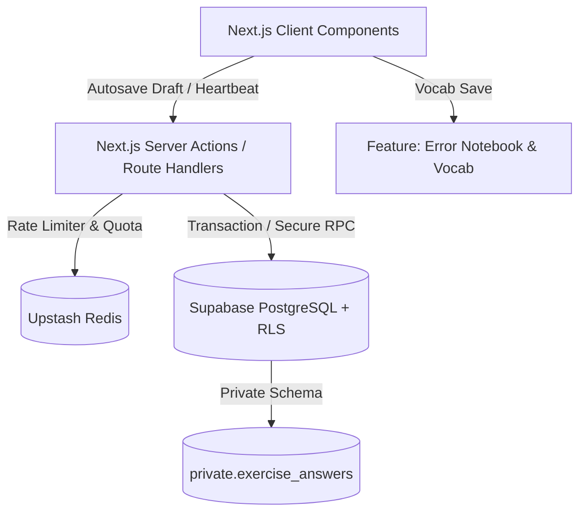
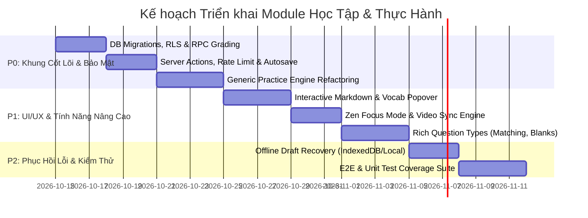

Dưới đây là kế hoạch kiến trúc và đặc tả kỹ thuật chi tiết toàn diện từ góc độ **Principal Architect**, được định dạng chuẩn Markdown sẵn sàng xuất ra file `specs/PLAN_PROJECT.md`.

---

```markdown
# KẾ HOẠCH PHÁT TRIỂN MODULE HỌC TẬP IELTS (LEARNING & PRACTICE ENGINE)
**Tài liệu:** `specs/PLAN_PROJECT.md`  
**Phiên bản:** v1.0.0  
**Tác giả:** Principal Software Architect  
**Hệ thống liên quan:** Next.js 16 (App Router) | React 19 | Supabase PostgreSQL 15+ | Tailwind CSS v4 | Upstash Redis

---

## 1. TỔNG QUAN KIẾN TRÚC & MỤC TIÊU (ARCHITECTURE OVERVIEW)

Module Học tập bao gồm 2 phân hệ cốt lõi:
1. **Theory Learning Engine (`/learn/[courseId]/[lessonId]`):** Trình phát nội dung lý thuyết đa phương tiện (Video HLS/DASH + Rich Markdown), tích hợp bộ công cụ tương tác từ vựng (Vocabulary Highlighter & Vault sync), giao diện Zen/Focus Mode chống phân tâm, đồng bộ tiến độ học theo thời gian thực.
2. **Interactive Practice Engine (`/practice/[exerciseId]`):** Bộ công cụ làm bài tập tương tác (Multiple Choice, Fill-in-the-blanks, Matching, Drag & Drop), kế thừa từ `Generic Practice Engine` (giải quyết nợ kỹ thuật DRY từ bản Audit), chấm điểm Server-Authoritative, chống gian lận thời gian và chống spam request.



---

## 2. KIẾN TRÚC DỮ LIỆU & BẢO MẬT (DATA SCHEMA & SECURITY)

### 2.1. Database Schema DDL (Supabase PostgreSQL)

```sql
-- 1. Bảng lưu trữ bài học lý thuyết
CREATE TABLE public.lessons (
    id UUID PRIMARY KEY DEFAULT gen_random_uuid(),
    course_id UUID NOT NULL,
    title VARCHAR(255) NOT NULL,
    slug VARCHAR(255) UNIQUE NOT NULL,
    video_url TEXT,
    content_markdown TEXT NOT NULL,
    duration_seconds INT NOT NULL DEFAULT 0,
    order_index INT NOT NULL,
    created_at TIMESTAMPTZ DEFAULT NOW(),
    updated_at TIMESTAMPTZ DEFAULT NOW()
);

-- 2. Bảng theo dõi tiến độ bài học (Lesson Progress)
CREATE TABLE public.user_lesson_progress (
    id UUID PRIMARY KEY DEFAULT gen_random_uuid(),
    user_id UUID NOT NULL REFERENCES auth.users(id) ON DELETE CASCADE,
    lesson_id UUID NOT NULL REFERENCES public.lessons(id) ON DELETE CASCADE,
    status VARCHAR(20) NOT NULL DEFAULT 'in_progress' CHECK (status IN ('in_progress', 'completed')),
    last_position_seconds INT NOT NULL DEFAULT 0,
    completion_percentage INT NOT NULL DEFAULT 0 CHECK (completion_percentage BETWEEN 0 AND 100),
    completed_at TIMESTAMPTZ,
    updated_at TIMESTAMPTZ DEFAULT NOW(),
    CONSTRAINT uq_user_lesson UNIQUE(user_id, lesson_id)
);

-- 3. Bảng bài tập thực hành (Practice Exercises)
CREATE TABLE public.practice_exercises (
    id UUID PRIMARY KEY DEFAULT gen_random_uuid(),
    lesson_id UUID REFERENCES public.lessons(id) ON DELETE SET NULL,
    title VARCHAR(255) NOT NULL,
    type VARCHAR(50) NOT NULL CHECK (type IN ('reading', 'listening', 'grammar', 'vocab')),
    time_limit_seconds INT NOT NULL DEFAULT 0, -- 0 = không giới hạn
    total_questions INT NOT NULL DEFAULT 0,
    passing_score_percentage INT NOT NULL DEFAULT 70,
    is_published BOOLEAN NOT NULL DEFAULT false,
    created_at TIMESTAMPTZ DEFAULT NOW()
);

-- 4. Bảng câu hỏi hiển thị cho Client (Public / RLS - Không chứa đáp án đúng)
CREATE TABLE public.exercise_questions (
    id UUID PRIMARY KEY DEFAULT gen_random_uuid(),
    exercise_id UUID NOT NULL REFERENCES public.practice_exercises(id) ON DELETE CASCADE,
    order_index INT NOT NULL,
    question_type VARCHAR(30) NOT NULL CHECK (question_type IN ('multiple_choice', 'fill_in_blanks', 'matching')),
    prompt TEXT NOT NULL,
    options JSONB, -- Array options cho MCQs, Matching pairs bên A
    matching_targets JSONB, -- Danh sách pairs bên B
    explanation TEXT, -- Chỉ trả về sau khi đã nộp bài
    created_at TIMESTAMPTZ DEFAULT NOW()
);

-- 5. Bảng đáp án bảo mật (Isolate trong Private Schema - Client KHÔNG THỂ SELECT)
CREATE SCHEMA IF NOT EXISTS private;

CREATE TABLE private.exercise_answer_keys (
    question_id UUID PRIMARY KEY REFERENCES public.exercise_questions(id) ON DELETE CASCADE,
    correct_answers JSONB NOT NULL, -- Giá trị đúng: ["A"], ["answer1", "answer2"]
    accepted_synonyms JSONB DEFAULT '[]'::jsonb, -- Từ đồng nghĩa chấp nhận được
    case_sensitive BOOLEAN NOT NULL DEFAULT false
);

-- 6. Bảng lưu lượt làm bài tập (Practice Attempts & Drafts)
CREATE TABLE public.exercise_attempts (
    id UUID PRIMARY KEY DEFAULT gen_random_uuid(),
    user_id UUID NOT NULL REFERENCES auth.users(id) ON DELETE CASCADE,
    exercise_id UUID NOT NULL REFERENCES public.practice_exercises(id) ON DELETE CASCADE,
    status VARCHAR(20) NOT NULL DEFAULT 'in_progress' CHECK (status IN ('in_progress', 'submitted', 'abandoned')),
    draft_answers JSONB DEFAULT '{}'::jsonb,
    started_at TIMESTAMPTZ NOT NULL DEFAULT NOW(),
    server_expires_at TIMESTAMPTZ, -- Server-authoritative deadline
    submitted_at TIMESTAMPTZ,
    score INT DEFAULT 0,
    max_score INT NOT NULL DEFAULT 0,
    accuracy_percentage NUMERIC(5,2) DEFAULT 0.00,
    created_at TIMESTAMPTZ DEFAULT NOW(),
    updated_at TIMESTAMPTZ DEFAULT NOW()
);

-- Chỉ mục hiệu năng tối ưu hóa tra cứu (Fix Gap Audit)
CREATE INDEX idx_user_lesson_progress_lookup ON public.user_lesson_progress(user_id, status);
CREATE INDEX idx_exercise_attempts_user_status ON public.exercise_attempts(user_id, status);
CREATE INDEX idx_exercise_attempts_exercise_created ON public.exercise_attempts(exercise_id, created_at DESC);
CREATE INDEX idx_exercise_questions_exercise_order ON public.exercise_questions(exercise_id, order_index);
```

### 2.2. Row-Level Security (RLS) & RPC Functions

```sql
-- Kích hoạt RLS
ALTER TABLE public.lessons ENABLE ROW LEVEL SECURITY;
ALTER TABLE public.user_lesson_progress ENABLE ROW LEVEL SECURITY;
ALTER TABLE public.practice_exercises ENABLE ROW LEVEL SECURITY;
ALTER TABLE public.exercise_questions ENABLE ROW LEVEL SECURITY;
ALTER TABLE public.exercise_attempts ENABLE ROW LEVEL SECURITY;

-- Policies cơ bản
CREATE POLICY "Public read lessons" ON public.lessons FOR SELECT TO authenticated USING (true);
CREATE POLICY "Public read exercises" ON public.practice_exercises FOR SELECT TO authenticated USING (is_published = true);
CREATE POLICY "Public read questions" ON public.exercise_questions FOR SELECT TO authenticated USING (true);

CREATE POLICY "Users own lesson progress" ON public.user_lesson_progress 
    FOR ALL TO authenticated USING (auth.uid() = user_id) WITH CHECK (auth.uid() = user_id);

CREATE POLICY "Users own attempts" ON public.exercise_attempts 
    FOR ALL TO authenticated USING (auth.uid() = user_id) WITH CHECK (auth.uid() = user_id);

-- Secure RPC: Nộp bài và chấm điểm Server-Authoritative
CREATE OR REPLACE FUNCTION public.submit_exercise_attempt(
    p_attempt_id UUID,
    p_user_answers JSONB
)
RETURNS JSONB
LANGUAGE plpgsql
SECURITY DEFINER
SET search_path = public, private
AS $$
DECLARE
    v_user_id UUID;
    v_exercise_id UUID;
    v_expires_at TIMESTAMPTZ;
    v_status VARCHAR(20);
    v_total_questions INT;
    v_correct_count INT := 0;
    v_q RECORD;
    v_correct_data JSONB;
    v_is_correct BOOLEAN;
    v_result_details JSONB := '[]'::jsonb;
BEGIN
    v_user_id := auth.uid();
    
    -- 1. Validate Attempt
    SELECT user_id, exercise_id, server_expires_at, status 
    INTO v_user_id, v_exercise_id, v_expires_at, v_status
    FROM public.exercise_attempts
    WHERE id = p_attempt_id;

    IF v_user_id IS NULL OR v_user_id <> auth.uid() THEN
        RAISE EXCEPTION 'Unauthorized attempt access';
    END IF;

    IF v_status = 'submitted' THEN
        RAISE EXCEPTION 'Attempt has already been submitted';
    END IF;

    -- Kiểm tra quá thời gian nộp bài cho phép (Grace period 15 giây)
    IF v_expires_at IS NOT NULL AND NOW() > (v_expires_at + INTERVAL '15 seconds') THEN
        UPDATE public.exercise_attempts SET status = 'abandoned' WHERE id = p_attempt_id;
        RAISE EXCEPTION 'Time limit exceeded. Attempt marked as abandoned';
    END IF;

    -- 2. Đánh giá kết quả từ Private Schema
    FOR v_q IN 
        SELECT eq.id, eq.question_type, eq.explanation, ak.correct_answers, ak.accepted_synonyms, ak.case_sensitive
        FROM public.exercise_questions eq
        JOIN private.exercise_answer_keys ak ON eq.id = ak.question_id
        WHERE eq.exercise_id = v_exercise_id
    LOOP
        v_is_correct := false;
        
        -- Logic kiểm tra câu trả lời dựa trên loại câu hỏi
        IF v_q.question_type = 'multiple_choice' THEN
            v_is_correct := (v_q.correct_answers = (p_user_answers->v_q.id::text));
        ELSIF v_q.question_type = 'fill_in_blanks' THEN
            -- So khớp case-insensitive và từ đồng nghĩa
            v_is_correct := (
                lower(trim(both '"' from (p_user_answers->v_q.id::text))) = lower(v_q.correct_answers->>0) OR
                v_q.accepted_synonyms @> p_user_answers->v_q.id::text
            );
        ELSIF v_q.question_type = 'matching' THEN
            v_is_correct := (v_q.correct_answers = (p_user_answers->v_q.id::text));
        END IF;

        IF v_is_correct THEN
            v_correct_count := v_correct_count + 1;
        END IF;

        v_result_details := v_result_details || jsonb_build_object(
            'question_id', v_q.id,
            'is_correct', v_is_correct,
            'correct_answer', v_q.correct_answers,
            'explanation', v_q.explanation
        );
    END LOOP;

    SELECT COUNT(*) INTO v_total_questions FROM public.exercise_questions WHERE exercise_id = v_exercise_id;

    -- 3. Cập nhật kết quả bài làm
    UPDATE public.exercise_attempts
    SET status = 'submitted',
        submitted_at = NOW(),
        score = v_correct_count,
        max_score = v_total_questions,
        accuracy_percentage = ROUND((v_correct_count::numeric / GREATEST(v_total_questions, 1)) * 100, 2),
        draft_answers = p_user_answers,
        updated_at = NOW()
    WHERE id = p_attempt_id;

    RETURN jsonb_build_object(
        'attempt_id', p_attempt_id,
        'score', v_correct_count,
        'max_score', v_total_questions,
        'accuracy_percentage', ROUND((v_correct_count::numeric / GREATEST(v_total_questions, 1)) * 100, 2),
        'results', v_result_details
    );
END;
$$;
```

---

## 3. THIẾT KẾ UI/UX SPECIFICATIONS

### 3.1. Trang Lý Thuyết (`/learn/[courseId]/[lessonId]`)
- **Zen / Focus Mode:** Một nút chuyển đổi kích hoạt giao diện mở rộng toàn màn hình: ẩn Sidebar, ẩn Top Navbar, thanh tiến độ bài học chuyển thành đường mỏng 2px ở đầu màn hình.
- **Video Player Pipeline:** Tự động khôi phục giây học dở (`last_position_seconds`), hỗ trợ phím tắt (`Space`: Play/Pause, `J`/`L`: Back/Forward 10s), chặn download video.
- **Vocabulary Interaction Floating Panel:** 
  - Người dùng bôi đen từ/cụm từ trong phần Markdown Text $\rightarrow$ xuất hiện Quick Action Popover (`Translate`, `Listen Pronunciation`, `Save to Error Notebook/Vocab Vault`).
  - Sử dụng Tailwind CSS v4 variables cho Dark Mode mượt mà (`bg-zinc-950`, `text-zinc-100`, `border-zinc-800`).

### 3.2. Trang Bài Tập Thực Hành (`/practice/[exerciseId]`)
- **Split-View / Full Container Layout:** Tùy chọn 2 cột (Left: ngữ cảnh/audio/bài đọc, Right: danh sách câu hỏi làm bài) hoặc 1 cột tập trung.
- **Question Navigator:** Mini-map bên cạnh hiển thị trạng thái từng câu (Chưa làm: Xám, Đã điền: Xanh dương, Đánh dấu xem lại: Vàng cờ).
- **Sticky Control Bar:** Hiển thị Server-Authoritative Countdown Timer, Thanh tiến độ hoàn thành (% câu đã làm), Nút "Lưu nháp" và Nút "Nộp bài" với Modal xác nhận.

---

## 4. CHI TIẾT CÁC TASK PHÁT TRIỂN (P0 / P1 / P2)



### 🔴 PHASE P0: CORE ENGINE, BẢO MẬT & SERVER INTEGRITY (Sprint 1 - Bắt buộc)

#### Task P0.1: Database Migrations & Private Schema Setup
- **Mục tiêu:** Tạo cấu trúc bảng, chuyển Answer Keys sang `private` schema, tạo RPC function `submit_exercise_attempt`.
- **Hành động kỹ thuật:**
  - Viết file migration: `supabase/migrations/20261015000000_learning_and_practice_core.sql`.
  - Phủ toàn bộ RLS policies cho bảng `lessons`, `user_lesson_progress`, `exercise_attempts`.
  - Thiết lập các composite indexes: `(user_id, status)` và `(exercise_id, created_at)`.
- **Definition of Done (DoD):** Migration chạy thành công không có lỗi, RLS chặn triệt để người dùng query trực tiếp `private.exercise_answer_keys`.

#### Task P0.2: Upstash Rate Limiting & Server Actions
- **Mục tiêu:** Bảo vệ API submit/draft chống spam và bot attack.
- **Hành động kỹ thuật:**
  - Tạo Server Action `saveExerciseDraftAction` với rate limit: 30 requests/phút/user.
  - Tạo Server Action `submitExerciseAction` với rate limit: 5 requests/phút/user.
  - Validate dữ liệu đầu vào bằng `zod`:
    ```typescript
    // src/features/practice/schema.ts
    export const SubmitExerciseSchema = z.object({
      attemptId: z.string().uuid(),
      answers: z.record(z.string().uuid(), z.union([z.string(), z.array(z.string())])),
    });
    ```
- **DoD:** Unit test verify request vượt quá quota trả về mã lỗi `429 Too Many Requests`.

#### Task P0.3: Unified Practice Runner (Giải quyết triệt để Nợ Kỹ Thuật DRY)
- **Mục tiêu:** Xây dựng `GenericPracticeEngine` để tái sử dụng cho Reading, Listening, Grammar và Practice runner chung.
- **Hành động kỹ thuật:**
  - Tạo `src/features/core-practice/components/generic-practice-engine.tsx`.
  - Đóng gói chung: Countdown Timer logic, Draft Autosave hook (`useAutosaveDraft`), Confirmation Dialog, Question Navigation map.
  - Refactor các components cũ chuyển sang kế thừa engine dùng chung.
- **DoD:** Giảm tối thiểu 30KB trùng lặp code client runner; các flow cũ chạy bình thường không regression.

---

### 🟡 PHASE P1: TÍNH NĂNG HỌC TẬP, UI/UX CHỐNG PHÂN TÂM (Sprint 2)

#### Task P1.1: Interactive Markdown Viewer & Vocabulary Highlighter
- **Mục tiêu:** Hiển thị bài đọc/lý thuyết tối ưu hiệu năng, cho phép tra và lưu từ trực tiếp.
- **Hành động kỹ thuật:**
  - Sử dụng `next/dynamic` cô lập `react-markdown` và `rehype-highlight` để không phình client bundle ban đầu:
    ```typescript
    const LessonMarkdown = dynamic(
      () => import('@/features/learning/components/lesson-markdown'),
      { ssr: false, loading: () => <MarkdownSkeleton /> }
    );
    ```
  - Xây dựng component `TextSelectionPopover.tsx`: Bắt sự kiện `window.getSelection()`, tính toán tọa độ floating panel và dispatch action lưu từ vào module `error-notebook` / `vocab-vault`.
- **DoD:** Bôi đen từ hiển thị menu tức thì (< 50ms), lưu từ vựng cập nhật ngay vào cơ sở dữ liệu.

#### Task P1.2: Video Player with Heartbeat Position Sync
- **Mục tiêu:** Phát video mượt mà và lưu lại giây đang học dở.
- **Hành động kỹ thuật:**
  - Xây dựng custom hook `useVideoProgressSync({ lessonId, interval: 10000 })`.
  - Lưu checkpoint vào `localStorage` mỗi 5s và đồng bộ lên database qua Server Action mỗi 15s hoặc khi `onPause` / `onBeforeUnload`.
  - Hỗ trợ Zen Focus Mode: Ẩn thanh điều hướng xung quanh với phím tắt `F` hoặc nút toggle UI.
- **DoD:** Tải lại trang (F5) video tự động tua đúng vị trí dừng lần cuối; thanh tiến độ bài học cập nhật theo tỷ lệ xem.

#### Task P1.3: Question Type Components Engine
- **Mục tiêu:** Xây dựng các dạng câu hỏi IELTS tương tác cao.
- **Hành động kỹ thuật:**
  - `MultipleChoiceQuestion.tsx`: Radio/Checkbox option với giao diện chuẩn thi quốc tế.
  - `FillInBlanksQuestion.tsx`: Inline inputs tích hợp trực tiếp trong đoạn văn.
  - `MatchingQuestion.tsx`: Kéo thả hoặc click-pair tương tác mượt trên cả Mobile & Desktop.
- **DoD:** Hỗ trợ đầy đủ keyboard accessibility (Tab, Enter, Arrow keys), trạng thái câu hỏi cập nhật lên Navigator đồng bộ.

---

### 🟢 PHASE P2: KHẢ NĂNG PHỤC HỒI, OFFLINE ENGINE & TEST SUITE (Sprint 3)

#### Task P2.1: Client-side Disaster Recovery (Offline/Disconnect Resilience)
- **Mục tiêu:** Đảm bảo không mất bài làm khi rớt mạng đột ngột.
- **Hành động kỹ thuật:**
  - Xây dựng lớp lưu trữ dự phòng `PracticeStorageCache` qua `localStorage` / `IndexedDB`.
  - Lắng nghe sự kiện `navigator.onLine` / `offline`. Hiển thị Toast cảnh báo "Mất kết nối Internet - Đang lưu bản nháp Offline" khi mạng ngắt.
  - Tự động sync lại toàn bộ câu trả lời nháp lên Server Action ngay khi có mạng trở lại.
- **DoD:** Kiểm thử ngắt mạng (DevTools Network Offline), người dùng tiếp tục làm bài và bật lại mạng, dữ liệu tự đồng bộ không mất ký tự nào.

#### Task P2.2: Automated Test Coverage Suite (Vitest + Playwright)
- **Mục tiêu:** Khóa an toàn toàn bộ tính năng với kiểm thử tự động.
- **Hành động kỹ thuật:**
  - **Unit Tests (Vitest):**
    - Kiểm thử thuật toán chấm điểm và xử lý case-insensitive của RPC `submit_exercise_attempt`.
    - Kiểm thử Zod schema và Rate Limiter logic.
  - **E2E Tests (Playwright):**
    - Viết `tests/e2e/learning-flow.spec.ts`: Vào học lý thuyết $\rightarrow$ Bôi đen lưu từ $\rightarrow$ Tua video $\rightarrow$ Đạt yêu cầu hoàn thành bài học.
    - Viết `tests/e2e/practice-engine.spec.ts`: Bắt đầu làm bài $\rightarrow$ Autosave draft kiểm tra DB $\rightarrow$ Hết giờ đếm ngược tự động nộp bài $\rightarrow$ Kiểm tra màn hình chấm điểm kết quả.
    - Viết `tests/e2e/network-resilience.spec.ts`: Giả lập rớt kết nối mạng trong khi làm bài và phục hồi thành công.
- **DoD:** Toàn bộ test suite pass 100%, không flaky, pipeline CI chạy sạch.

---

## 5. CẤU TRÚC THƯ MỤC TRIỂN KHAI (FSD STANDARDIZATION)

```text
src/
├── app/
│   ├── (dashboard)/
│   │   ├── learn/
│   │   │   └── [courseId]/
│   │   │       └── [lessonId]/
│   │   │           ├── page.tsx
│   │   │           └── loading.tsx
│   │   └── practice/
│   │       └── [exerciseId]/
│   │           ├── page.tsx
│   │           └── loading.tsx
├── features/
│   ├── learning/
│   │   ├── api/
│   │   │   ├── get-lesson.ts
│   │   │   └── update-progress-action.ts
│   │   ├── components/
│   │   │   ├── lesson-markdown.tsx
│   │   │   ├── video-player.tsx
│   │   │   ├── vocab-highlight-popover.tsx
│   │   │   └── zen-mode-toggle.tsx
│   │   ├── hooks/
│   │   │   └── use-video-sync.ts
│   │   └── types/index.ts
│   └── core-practice/
│       ├── api/
│       │   ├── save-draft-action.ts
│       │   └── submit-attempt-action.ts
│       ├── components/
│       │   ├── generic-practice-engine.tsx
│       │   ├── question-navigator.tsx
│       │   ├── server-timer.tsx
│       │   ├── questions/
│       │   │   ├── multiple-choice.tsx
│       │   │   ├── fill-in-blanks.tsx
│       │   │   └── matching-pair.tsx
│       │   └── submit-confirm-modal.tsx
│       ├── hooks/
│       │   ├── use-autosave-draft.ts
│       │   └── use-disaster-recovery.ts
│       └── types/index.ts
```

---

## 6. MA TRẬN ĐÁNH GIÁ VÀ TIÊU CHUẨN NGHIỆM THU (ACCEPTANCE CRITERIA)

| Hạng mục | Tiêu chuẩn Đạt yêu cầu (Pass) | Rủi ro / Điểm cần kiểm soát |
| :--- | :--- | :--- |
| **Bảo mật Đáp án** | Zero-leakage: Payload trả về Client trước khi submit không chứa trường đáp án đúng. | Schema isolation: Kiểm tra cẩn thận RLS và không để lộ RPC function ra ngoài schema cho phép. |
| **Tính Đúng đắn Timer** | Server-Authoritative: Không thể hack thời gian từ Client Local Clock. | Mạng trễ: Cung cấp grace period 15 giây chống timeout do mạng chậm. |
| **Performance FCP / LCP** | FCP < 1.2s, LCP < 2.0s trên mobile mạng 4G. | Dynamic import triệt để các thư viện nặng (`react-markdown`, Audio Visualizers). |
| **Trải nghiệm Học tập** | Zen mode loại bỏ phân tâm, tiến độ học dở phục hồi mượt mà. | Tránh spam gọi update database liên tục: bắt buộc dùng kỹ thuật Debounce và Window Beacon/Keepalive. |
```